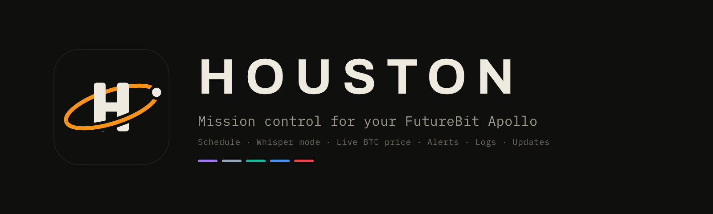
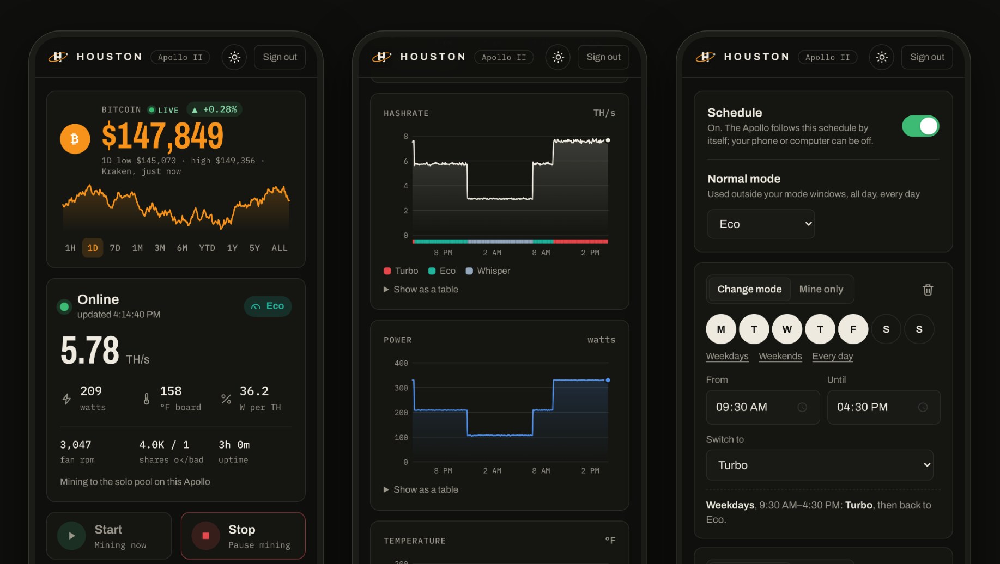
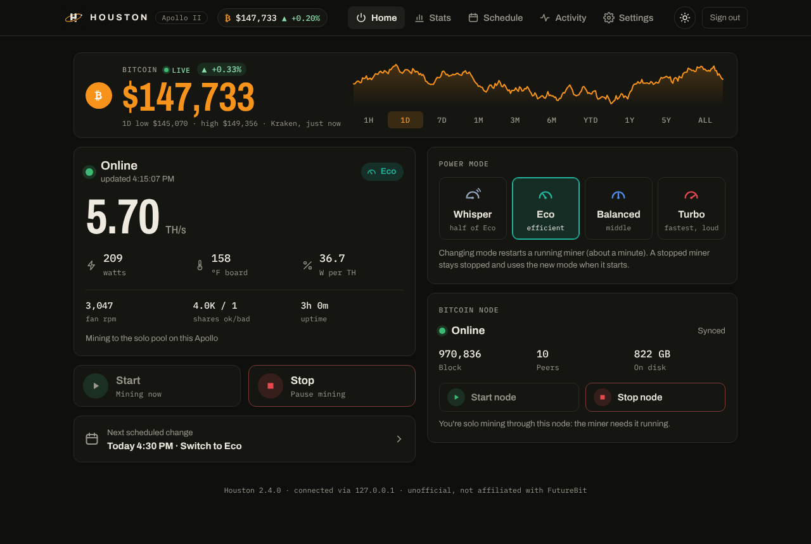
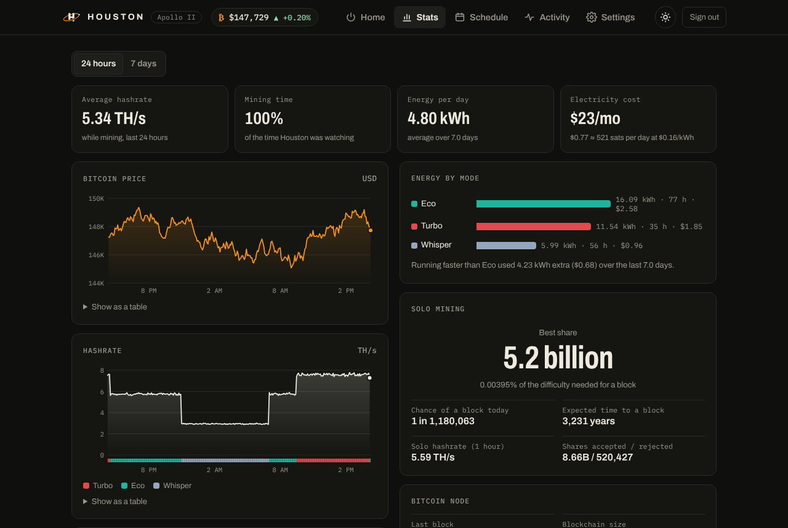
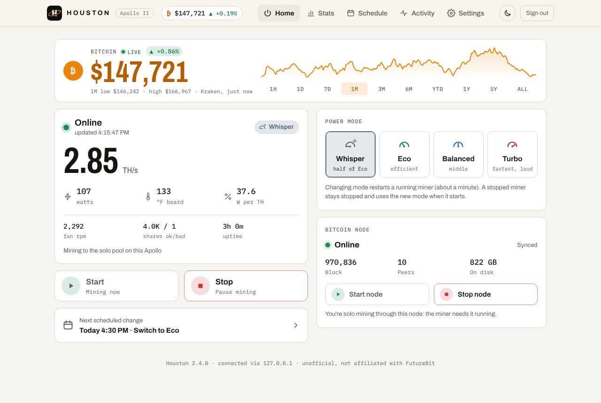

**Houston** is mission control for the **FutureBit Apollo II and Apollo III** home bitcoin miners. It's an app that runs on the Apollo itself and works on your phone and computer, at home or anywhere:

- **Live bitcoin price**: refreshed every 5 seconds while Houston is open, with time frames from 1 hour to all-time (1H … 5Y, ALL) and a chart on Stats (USD, EUR, GBP, CAD, AUD, JPY or CHF)
- **Control**: start, stop, Eco / Balanced / Turbo, plus Houston's own **Whisper** mode on the Apollo II (half of Eco's power, the quietest). Apollo III: Super Eco and a custom 5–20 TH/s target. Start/stop the Bitcoin node too
- **Schedule**: e.g. quiet Eco around the clock, Turbo on weekdays while nobody's home. The Apollo runs it itself, so no computer has to stay on
- **Stats**: 24-hour and 7-day charts, electricity cost (and what Turbo adds), solo-mining odds and best share, node and system health
- **Bitcoin network & market**: Fear & Greed Index, block height and time since the last block, block time and difficulty, market cap, dominance, volume, sats per dollar, and the latest headlines
- **Apollo software updates**: see when FutureBit releases a new version and install it from Houston, with progress
- **System logs**: the Apollo's miner, node, solo pool and system logs, filterable and live
- **Front status light**: turn the light on the front of the Apollo off (or on)
- **Alerts** on your phone when the miner stops, runs hot, loses hashrate, its node stops or its drive fills up (and when your solo pool finds a block, or new Apollo software is out): as regular notifications from the Houston app, or through the free ntfy app
- **Siri and shortcuts**: "Hey Siri, Apollo status". Google Home works through Home Assistant
- **Several Apollos** in one place
- **Light or dark**, or follow your phone or computer
- **Desktop shortcuts** (optional) for Windows, macOS and Linux: open Houston, or one-click Start / Stop / Status / modes









*Screenshots use demo data.*

> Unofficial community project. Not affiliated with or endorsed by FutureBit. Use at your own risk.

## Quick start

You need your Apollo's address (the one you open the dashboard at, e.g. `192.168.1.50`) and your dashboard password. Tip: give the Apollo a fixed address in your router (a "DHCP reservation").

**1. Install Houston on the Apollo** (once). From a computer on your home network, in the unzipped folder (on Windows, use PowerShell):

```bash
scp -r houston futurebit@192.168.1.50:~/
ssh -t futurebit@192.168.1.50 "sudo bash ~/houston/install-houston.sh"
```

Both ask for your dashboard password. The installer sets up Houston on port 8088 and Tailscale for access away from home (it prints a sign-in link: open it, approve, wait). Full guide: [docs/houston.md](docs/houston.md).

**2. Open Houston** at `http://192.168.1.50:8088` (at home) or the Tailscale address it printed (anywhere), and sign in. On a phone, add it to your home screen.

**3. Optional: desktop shortcuts.** Run the setup for your computer. It finds the Apollo, connects to Houston and adds the shortcuts you pick:

| | Set up | Remove | Guide |
|---|---|---|---|
| **Windows** | Unblock the zip (right-click › Properties › **Unblock**), unzip somewhere permanent like `C:\Houston`, double-click **`Setup.bat`** | `Uninstall.bat` | [Windows](docs/windows.md) |
| **macOS** | Unzip, open the `macos` folder, **right-click `Setup.command` › Open** | `Uninstall.command` | [macOS](docs/macos.md) |
| **Linux** | Unzip, run `bash linux/setup.sh` | `bash linux/uninstall.sh` | [Linux](docs/linux.md) |

Can't install Houston? The desktop setups can still create one-click shortcuts and a schedule that runs on your computer (only while it's on).

## How it works

The Apollo's dashboard talks to an API on port 5000 of the Apollo itself. Houston uses that same API with your dashboard password, so it sends exactly the commands the dashboard does (start, stop, save mode, restart) and keeps working when the dashboard's layout changes. No browser automation, no cloud service, nothing opened to the internet. Details: [docs/how-it-works.md](docs/how-it-works.md).

## Compatibility

- **Apollo II:** tested on real hardware with Apollo Web OS **v2.1.x** (the tools Houston grew out of). Houston itself is tested against FutureBit's real API code; reports from real units welcome.
- **Apollo III:** built from FutureBit's Apollo III source (Apollo OS 2.1.3/2.1.4) and tested against that API, not yet on a real unit. See [docs/apollo-iii.md](docs/apollo-iii.md).
- **Apollo (original):** should work (same API). Please report results.
- **Phones:** any modern browser (Android, iPhone). **Computers:** any browser; desktop setups for Windows 10/11 (nothing to install), macOS (nothing to install) and Linux.
- Test status per piece: the Houston server and app are tested end to end against stand-ins built from FutureBit's API code (Apollo II and III). The Windows setup window has been tested on a real Windows PC. The macOS setup is tested with stand-ins for the macOS tools. Reports welcome.

## Folder layout

```
houston/                   Houston: install-houston.sh, the server (houston.py) and the app (web/). Runs on the Apollo
Setup.bat, Uninstall.bat   Windows desktop setup / removal
windows/                   setup window, text setup, apollo-miner.ps1, icons
macos/                     Setup.command, Uninstall.command, icons
linux/                     setup.sh, uninstall.sh, icons
scripts/                   apollo-miner.sh (command line: macOS / Linux / the Apollo) + apollo-setup.sh
docs/                      guides
```

## Docs

- [Houston: install, the app, alerts, several Apollos, updating](docs/houston.md)
- [Siri, Android shortcuts and Google Home](docs/voice-assistants.md)
- [Windows](docs/windows.md) · [macOS](docs/macos.md) · [Linux](docs/linux.md) desktop setup
- [Apollo III: Super Eco and custom hashrate targets](docs/apollo-iii.md)
- [Command line and cron, without Houston](docs/command-line.md)
- [Troubleshooting](docs/troubleshooting.md), including the "Failed to fetch" dashboard after an Apollo update
- [How it works (API notes)](docs/how-it-works.md)
- [Security](SECURITY.md) and the full [security review](docs/security-review.md): what Houston stores, what it connects to, and how it's protected. Please read them before exposing anything beyond your home network.
- [Changelog](CHANGELOG.md)

## Credits

Idea, real-hardware testing and sharing by **[@eisenreich](https://x.com/eisenreich)**, who wanted their Apollo to mine on a schedule without clicking through the dashboard.
Code, design and docs by **Claude** (Anthropic's AI assistant), written during that conversation.

## Support the project

Houston is free and always will be. If it saves you some clicks (or some electricity), a tip in bitcoin is appreciated:


`bc1qpcu0elnfkqw7y7z8c8qfmyf6xkvktdv5q7ujh0`

Bug reports, Apollo III test results and ideas help just as much.

## License

MIT. See [LICENSE](LICENSE).
